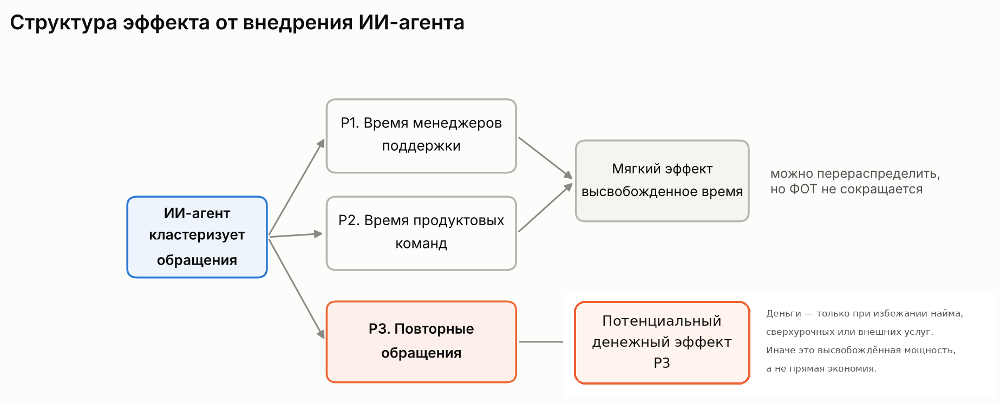
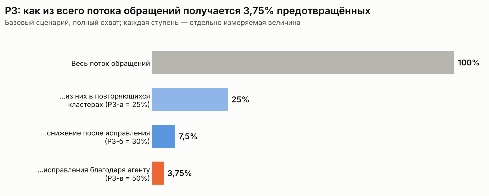
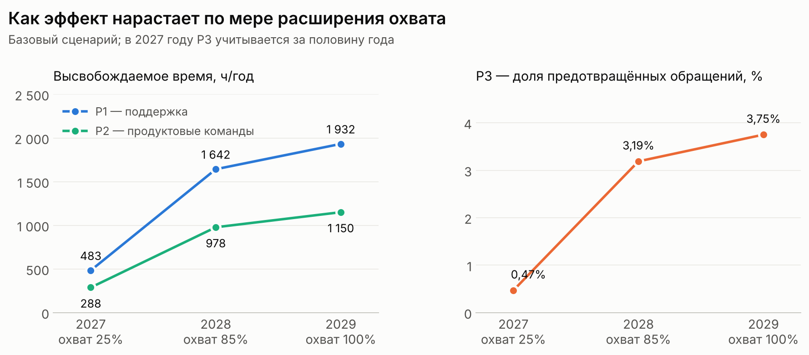
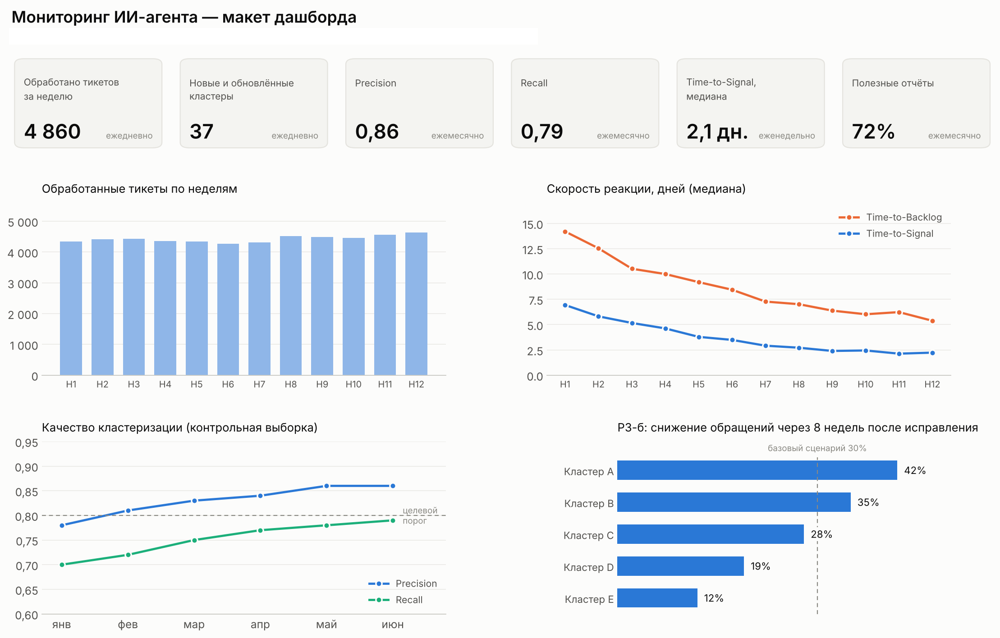
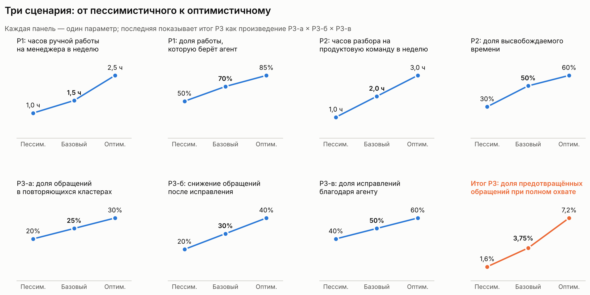
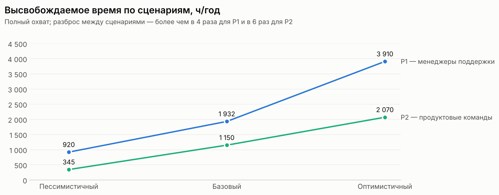
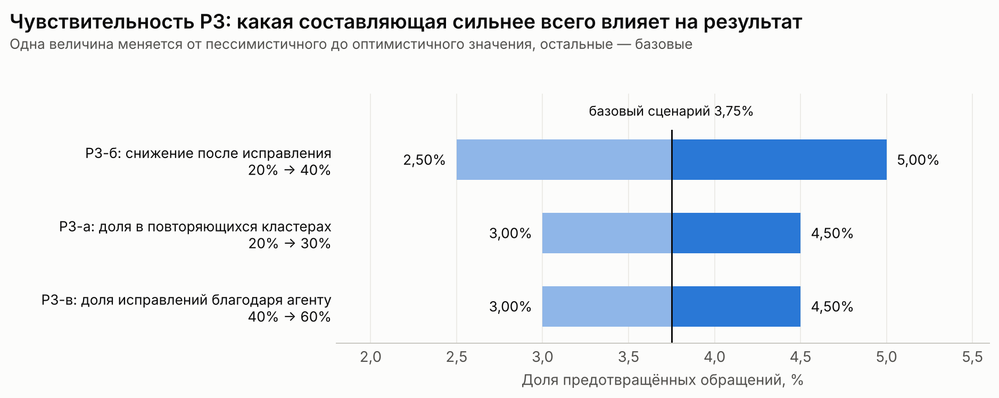

# 5. Оценка эффекта внедрения ИИ-агента

## 5.1. Цель и логика оценки

Эффект внедрения ИИ-агента оценивается по тому, насколько система снижает трудоёмкость обработки пользовательской обратной связи, ускоряет выявление повторяющихся проблем и помогает предотвращать повторные обращения пользователей.

Выделяются три источника эффекта:

- **Р1 — высвобождение времени менеджеров технической поддержки.** Агент автоматически собирает и систематизирует повторяющиеся обращения, поэтому менеджеры тратят меньше времени на ручной поиск, группировку и передачу пожеланий.
- **Р2 — высвобождение времени продуктовых команд.** Команды получают готовые аналитические карточки вместо самостоятельного изучения массива отдельных тикетов.
- **Р3 — сокращение повторных обращений.** Если повторяющаяся проблема раньше выявлена и исправлена, пользователи реже обращаются в поддержку по той же причине. Именно этот эффект формирует прямую экономию.

Р1 и Р2 являются **мягким эффектом производительности**: высвобожденное время можно направить на другие задачи, но оно само по себе не сокращает фонд оплаты труда. Р3 создаёт **потенциальный денежный эффект** только тогда, когда предотвращённые обращения позволяют избежать найма, сверхурочных или внешних услуг. Если численность и расходы не меняются, снижение обращений также следует считать высвобождением мощности, а не прямой экономией.

Для расчёта эффекта используются допущения базового сценария. Число 40 менеджеров и срок хранения тикетов 1 год заданы кейсом; 25 продуктовых команд, 500 тыс. тикетов в год, рост потока 7%, 7 минут работы на обращение и параметры автоматизации — проектные допущения. Их фактические значения должны быть подтверждены ретроспективным анализом, хронометражем и пилотом внедрением, а не приниматься как заранее гарантированный результат.

## 5.2. Основные метрики

### Р1. Сокращение времени менеджеров технической поддержки на ручной анализ

**Что измеряем:** время, которое менеджеры тратят на поиск повторяющихся обращений, сбор примеров, подготовку сводок и передачу информации продуктовым командам.

Базовый сценарий предполагает:

- 40 менеджеров технической поддержки;
- 1,5 часа в неделю на одного менеджера на ручной сбор и передачу пожеланий;
- 70% этой работы выполняет агент;
- 46 рабочих недель в году.

Формула годового высвобождения времени:

$$
H_{R1}=N_{support}\times h_{week}\times W\times K_{automation}\times K_{coverage},
$$

где:

- $N_{support}$ — количество менеджеров, участвующих в процессе;
- $h_{week}$ — фактическое среднее время ручной работы одного менеджера за неделю;
- $W$ — количество рабочих недель в году;
- $K_{automation}$ — доля операций, которую агент действительно берёт на себя;
- $K_{coverage}$ — доля продуктов или процесса, охваченная внедрением.

При базовых допущениях и полном охвате:

$$
H_{R1}=40\times1{,}5\times46\times0{,}70=1\,932\text{ ч/год}.
$$

Это расчётное значение базового сценария, а не подтверждённый результат. Фактическое значение определяется на пилоте сравнением времени до и после внедрения. При замере после внедрения необходимо учитывать время сотрудников на проверку и корректировку результатов агента.

**Как измерять:** провести двухнедельный хронометраж или дневник трудозатрат менеджеров. Фиксировать время только на перечисленные операции, а не общее время обработки всех тикетов. Дополнительно использовать журналы выгрузок и действий в системе, если они доступны.

### Р2. Сокращение времени продуктовых команд на разбор обращений

**Что измеряем:** время продуктовых менеджеров и аналитиков, затрачиваемое на самостоятельный просмотр тикетов, поиск повторов, подготовку сводок и первичную систематизацию пользовательской обратной связи.

В базовом сценарии используются следующие допущения:

- 25 продуктовых команд;
- 2 часа в неделю на одну команду на разбор обратной связи;
- 50% этой работы снимается за счёт готовых карточек и отчётов агента;
- 46 рабочих недель в году.

Формула годового высвобождения времени:

$$
H_{R2}=N_{teams}\times h_{team}\times W\times K_{saving}\times K_{coverage},
$$

где:

- $N_{teams}$ — количество продуктовых команд, использующих аналитику;
- $h_{team}$ — фактическое время команды на ручной разбор обратной связи за неделю;
- $K_{saving}$ — доля времени, которую удаётся высвободить благодаря отчётам агента;
- остальные обозначения аналогичны Р1.

При базовых допущениях и полном охвате:

$$
H_{R2}=25\times2\times46\times0{,}50=1\,150\text{ ч/год}.
$$

**Как измерять:** провести опрос и двухнедельный хронометраж представителей продуктовых команд до пилота, а затем повторить замер после подключения агента. Время на проверку отчётов и принятие решений следует учитывать отдельно, чтобы не завысить экономию.

Высвобожденное время по Р1 и Р2 отражает рост производительности и возможность перераспределить ресурсы на другие задачи. Этот эффект не следует выдавать за прямое сокращение денежных расходов.

### Р3. Сокращение повторных обращений благодаря агенту

Р3 — основной показатель, связывающий результаты работы агента с прямым финансовым эффектом. Доля предотвращённых обращений рассчитывается как произведение трёх измеряемых величин:

$$
K_{R3}=K_{clusters}\times K_{reduction}\times K_{attribution}.
$$

В базовом сценарии:

$$
K_{R3}=25\%\times30\%\times50\%=3{,}75\%.
$$

Таким образом, при полном охвате и прочих равных условиях базовый сценарий предполагает предотвращение 3,75% общего потока обращений. Каждая составляющая должна измеряться отдельно.

#### Р3-а. Доля обращений, входящих в повторяющиеся продуктовые кластеры

**Что измеряем:** долю обращений, которые относятся к повторяющимся продуктовым проблемам или потребностям и могут быть объединены в тематические кластеры.

$$
K_{clusters}=\frac{N_{tickets\ in\ recurring\ clusters}}{N_{eligible\ tickets}}\times100\%.
$$

В базовом сценарии используется значение **25%**. Само значение является допущением: оно должно быть проверено на годовом архиве тикетов и экспертной выборке.

**Как измерять:** запустить ретроспективную обработку обращений за последние 12 месяцев. Агент группирует обращения по продуктам и смыслу; затем на контрольной выборке эксперты проверяют корректность кластеров. В числитель включаются тикеты, отнесённые к подтверждённым повторяющимся продуктовым кластерам, а в знаменатель — все обращения, входящие в согласованный контур анализа.

До расчёта необходимо зафиксировать правила формирования кластера: минимальное число связанных обращений, временное окно, допустимые категории и правила исключения нерелевантных тикетов. Эти параметры нельзя менять между базовым и последующим замером без пересчёта исходного значения.

#### Р3-б. Снижение повторных обращений после исправления проблемы

**Что измеряем:** насколько сокращается количество обращений по конкретной проблеме после выпуска исправления или изменения функциональности.

В базовом сценарии предполагается снижение повторных обращений на **30% через 8 недель после релиза исправления**. Это целевой сценарный параметр, а не уже измеренный результат; при недостаточном количестве исправлений на пилоте оценка остаётся предварительной.

Для оценки используется следующая формула:

$$
K_{reduction}=\frac{N_{expected}-N_{after}}{N_{expected}}\times100\%,
$$

где:

- $N_{expected}$ — ожидаемое количество обращений за 8 недель при отсутствии исправления;
- $N_{after}$ — фактическое количество обращений по той же проблеме за 8 недель после выпуска исправления.

Ожидаемое значение желательно определять с учётом динамики обращений до релиза и контрольной группы сопоставимых продуктов или проблем. Если контрольная группа недоступна, следует как минимум нормировать количество обращений на общий объём обращений по продукту или на пользовательскую активность, если такие данные имеются. Простое сравнение абсолютных значений до и после релиза может быть искажено сезонностью и изменением числа пользователей.

**Как измерять:** для каждого исправленного кластера фиксировать дату релиза, собирать обращения в течение восьми недель после него и сравнивать фактический результат с ожидаемым уровнем без исправления. Расчёт проводить по каждому кластеру, а затем агрегировать результаты по числу обращений или по согласованному способу взвешивания.

Если в пилотный период ещё не накоплено восемь недель после выпуска исправления, показатель считается предварительным и не используется как подтверждённый результат.

#### Р3-в. Доля исправлений, появившихся или ускорившихся благодаря агенту

**Что измеряем:** долю исправлений по повторяющимся проблемам, появление или более раннее рассмотрение которых было обусловлено аналитикой агента.

$$
K_{attribution}=\frac{N_{agent\text{-}enabled/accelerated\ fixes}}{N_{relevant\ fixes}}\times100\%.
$$

В базовом сценарии используется значение **50%**. Значение подтверждается только по журналу решений владельца продукта и датам появления/ускорения задач.

Исправление относится к данной категории только при наличии подтверждения продуктовой команды и записанного основания. Следует разделять два случая:

1. **Проблема выявлена благодаря агенту:** до передачи отчёта она не была зарегистрирована в backlog или не рассматривалась как повторяющаяся потребность; отчёт агента стал существенным основанием для постановки задачи.
2. **Рассмотрение проблемы ускорено агентом:** проблема уже была известна, но агрегированные обращения и оценка масштаба позволили раньше создать задачу, повысить её приоритет или приблизить выпуск исправления.

Для подтверждения необходимо сохранять дату формирования отчёта, дату появления или изменения задачи в backlog, решение владельца продукта и ссылку на соответствующий кластер. На этапе масштабирования оценку следует дополнить сравнением пилотных и контрольных продуктов, чтобы отделить вклад агента от обычной динамики разработки.

**Как измерять:** по каждому исправлению продуктовая команда фиксирует, было ли оно выявлено или ускорено благодаря отчёту агента, и прикладывает подтверждение. Затем рассчитывается доля таких исправлений среди всех исправлений по релевантным повторяющимся кластерам за период.

### Дополнительные показатели качества и скорости

Показатели Р1–Р3 характеризуют экономический эффект, но для принятия решения о масштабировании необходимо контролировать и качество работы агента:

| Метрика | Способ расчёта | Назначение |
|---|---|---|
| Precision | $TP/(TP+FP)$ | Доля корректных объединений среди всех объединений, предложенных агентом |
| Recall | $TP/(TP+FN)$ | Доля реально существующих повторяющихся тем, найденных агентом |
| F1-score | $2\times Precision\times Recall/(Precision+Recall)$ | Сводная оценка точности и полноты кластеризации |
| Time-to-Signal | Время от достижения кластером установленного порога повторяемости до формирования отчёта | Скорость обнаружения темы |
| Time-to-Backlog | Время от подтверждённого сигнала до создания или обновления задачи в backlog | Скорость реакции продуктовой команды |
| Полезность отчётов | Доля оценённых продуктовой командой отчётов, признанных полезными | Практическая применимость результатов |

Для Precision и Recall используется экспертно размеченная контрольная выборка. В терминах кластеризации TP — пары обращений, которые и агент, и эксперты относят к одной теме; FP — пары, ошибочно объединённые агентом; FN — пары одной реальной темы, которые агент не объединил. Эти показатели выступают критериями качества и не заменяют составляющие Р3.

## 5.3. Получение исходных значений до внедрения

Для формирования базовой линии предлагается использовать следующие источники и методы.

| Что необходимо измерить | Источник и метод | Результат |
|---|---|---|
| Доля обращений в повторяющихся кластерах (Р3-а) | Ретроспективный прогон обращений за 12 месяцев и экспертная проверка выборки | Базовая доля повторяющихся обращений; проверка допущения 25% |
| Снижение обращений после исправлений (Р3-б) | История релизов, тикеты до и после релиза, восьминедельные окна наблюдения | Фактическое снижение повторных обращений; проверка допущения 30% |
| Вклад агента в появление или ускорение исправлений (Р3-в) | История backlog, даты отчётов и задач, подтверждения продуктовых команд; далее — сравнение с контрольными продуктами | Доля исправлений, выявленных или ускоренных агентом; проверка допущения 50% |
| Время ручной работы поддержки (Р1) | Опрос, двухнедельный дневник трудозатрат и журналы выгрузок/действий | Среднее время в неделю на одного менеджера и доля автоматизируемых операций |
| Время продуктовых команд (Р2) | Опрос и двухнедельный дневник трудозатрат продуктовых команд | Среднее время в неделю на команду и доля времени, высвобождаемая отчётами |
| Качество кластеризации | Независимая экспертная разметка контрольной выборки | Precision, Recall и F1-score до принятия решения о масштабировании |

В кейсе известны ориентировочно 40 менеджеров поддержки и годовой срок хранения обращений, но фактическое распределение времени сотрудников на анализ обратной связи не задано. Поэтому значения Р1 и Р2 нельзя надёжно восстановить только по базе тикетов. Для них необходимо провести опрос и хронометраж.

Ретроспективный прогон за год позволяет оценить долю обращений в повторяющихся кластерах, но сам по себе не доказывает, что исправление проблемы снизило число обращений или что исправление появилось благодаря агенту. Для Р3-б и Р3-в нужны сведения о релизах, backlog и последующем поведении обращений. Если исторических данных недостаточно, соответствующие показатели собираются проспективно в ходе пилота.

## 5.4. Пилотное внедрение и проверка допущений

Предлагается провести пилот на двух цифровых продуктах в I–II кварталах 2027 года. На пилоте необходимо проверить:

1. Корректность классификации обращений и формирования кластеров — Precision, Recall и F1-score.
2. Фактическую долю обращений, попадающих в повторяющиеся кластеры, — Р3-а.
3. Изменение времени менеджеров поддержки на ручной сбор и передачу пожеланий — Р1.
4. Изменение времени продуктовых команд на разбор обратной связи — Р2.
5. Снижение повторных обращений в течение восьми недель после исправления — Р3-б.
6. Долю исправлений, выявленных или ускоренных благодаря агенту, — Р3-в.
7. Изменение Time-to-Signal и Time-to-Backlog.

Для каждого показателя фиксируются исходное значение, значение на пилоте, период наблюдения и источник данных. На время пилота желательно сохранить сопоставимый процесс измерений на продуктах, где агент не используется, либо подобрать контрольные продукты с близкой динамикой обращений.

Предполагается постепенное расширение охвата: 25% в 2027 году, 85% в 2028 году и 100% в 2029 году. Это плановый сценарий масштабирования, а не подтверждённая дорожная карта заказчика. График показывает, как по мере роста охвата нарастает эффект в базовом сценарии:

В первый год эффект Р3 учитывается за половину года, поскольку после выявления проблемы требуется время на её исправление и последующее восьминедельное наблюдение. Эти значения являются сценарными параметрами; фактический график масштабирования должен корректироваться по итогам пилота.

## 5.5. Мониторинг после внедрения

После запуска сбор данных необходимо автоматизировать. Источниками должны выступать база тикетов, аналитическое хранилище кластеров, журнал событий агента, история задач продуктовых команд и результаты хронометража.

| Показатель | Периодичность контроля |
|---|---|
| Количество обработанных тикетов и распределение по категориям | Ежедневно |
| Количество новых и обновлённых кластеров | Ежедневно |
| Time-to-Signal и Time-to-Backlog | Еженедельно |
| Результаты проверки отчётов продуктовыми командами | По мере рассмотрения отчётов, сводка ежемесячно |
| Precision, Recall и F1-score | Ежемесячно на контрольной выборке |
| Р1 и Р2: фактическое высвобождение времени | Повторный двухнедельный замер после пилота, далее ежеквартально или при существенном изменении процесса |
| Р3-б: изменение обращений после исправления | Через 8 недель после каждого релиза, затем агрегированная сводка ежеквартально |
| Р3-в: вклад агента в появление или ускорение исправлений | Ежеквартально по истории backlog и подтверждениям продуктовых команд |

Для предотвращения искажения результатов необходимо сохранять единые правила расчёта показателей, версии классификатора и промпта, идентификаторы кластеров, даты релизов и историю изменений. При изменении методики исходные значения следует пересчитать либо явно обозначить разрыв в динамике.

Состав показателей удобно свести в единый дашборд мониторинга. Ниже приведён макет такого дашборда; значения на нём условные и показывают только структуру и вид представления данных.

## 5.6. Альтернативные способы измерения при отсутствии данных

| Недоступные данные | Альтернативный способ |
|---|---|
| История ручного анализа обращений | Двухнедельный дневник трудозатрат, опрос и выборочный хронометраж менеджеров поддержки |
| История времени продуктовых команд | Дневник трудозатрат продуктовых менеджеров и аналитиков на пилотных продуктах |
| Данные о повторяемости проблем за прошлый период | Ретроспективная ручная разметка репрезентативной выборки тикетов и последующая проверка результатами агента |
| История релизов или связи релиза с тикетами | Проспективная фиксация даты исправления и восьминедельного окна наблюдения на пилоте |
| История создания и изменения задач backlog | Подтверждение продуктового владельца с фиксацией даты, основания и ссылки на отчёт агента; далее — обязательный журнал backlog |
| Контрольная группа продуктов | Сопоставление с исторической динамикой аналогичных проблем и нормирование на объём обращений; выводы отмечаются как менее надёжные |

Если исторических данных недостаточно, нельзя подменять их предположениями и выдавать расчёт за фактический эффект. В таком случае допущения сохраняются как сценарные, а решение о масштабировании принимается после получения результатов пилота.

## 5.7. Сценарные значения для проверки допущений

Рассматриваются три сценария. Их значения следует использовать как диапазоны для проверки чувствительности, а не как заранее установленные результаты пилота.

Все параметры растут от пессимистичного сценария к оптимистичному, но итог Р3 растёт значительно быстрее отдельных составляющих: он является произведением трёх величин, поэтому умеренные различия в каждой из них дают разброс результата в 4,5 раза — от 1,6% до 7,2% потока обращений.

Для Р1 и Р2 разброс также существенен: высвобождаемое время меняется от 920 до 3 910 ч/год для менеджеров поддержки и от 345 до 2 070 ч/год для продуктовых команд. Поэтому фактические значения времени ручной работы, полученные хронометражем, важнее принятых допущений.

Наибольшее влияние на итог Р3 оказывает Р3-б — снижение обращений после исправления: его диапазон даёт разброс от 2,5% до 5,0%. Следовательно, на пилоте именно этот показатель требует наиболее аккуратного измерения с учётом контрольной группы и нормирования на объём обращений.

После пилота фактические значения Р1–Р3 подставляются в расчёт вместо сценарных. Это позволяет проверить, сохраняется ли ожидаемый эффект и оправдано ли дальнейшее тиражирование.

## 5.8. Критерии успешности

Проект считается готовым к масштабированию, если одновременно выполняются следующие условия:

- Precision и Recall кластеризации достигают заранее согласованных целевых значений, а критические ошибки группировки не носят систематического характера.
- Фактические измерения Р1 и Р2 подтверждают высвобождение времени сотрудников с учётом затрат на проверку отчётов.
- Р3-а, Р3-б и Р3-в измерены по согласованной методике, а их значения позволяют пересчитать ожидаемый эффект.
- Продуктовые команды подтверждают полезность аналитических отчётов и используют их при рассмотрении проблем и пожеланий.
- Система сохраняет связь каждого вывода с исходными тикетами, журналирует действия и не создаёт неконтролируемых изменений в системе поддержки.

Численные пороги качества и минимально допустимый эффект необходимо утвердить до завершения пилота. Если фактические показатели существенно ниже базового сценария, следует пересчитать ожидаемый эффект и принять отдельное решение о продолжении проекта.

## Вывод

Для оценки эффекта внедрения ИИ-агента предлагается использовать три группы показателей: высвобождение времени менеджеров поддержки (Р1), высвобождение времени продуктовых команд (Р2) и сокращение повторных обращений (Р3). Основной вклад в прямой финансовый эффект формирует Р3, рассчитываемый как произведение доли обращений в повторяющихся кластерах, снижения обращений после исправления и доли исправлений, появившихся или ускорившихся благодаря агенту.

Исходные значения предлагается получить ретроспективным анализом тикетов за 12 месяцев, экспертной проверкой кластеров, двухнедельным хронометражем сотрудников и анализом истории релизов и backlog. На пилоте в двух продуктах необходимо повторно измерить Р1–Р3, а после внедрения организовать регулярный мониторинг через аналитическое хранилище и журналы событий.

Такой подход позволит не только оценить качество работы ИИ-агента, но и проверить ключевые допущения расчёта эффекта. По итогам пилота значения Р1–Р3 должны быть уточнены, после чего ожидаемый эффект пересчитывается перед принятием решения о масштабировании.

---

*Значения 25%, 30%, 50%, параметры Р1 и Р2, годовой поток 500 тыс. тикетов, рост 7% и средняя длительность обработки 7 минут являются допущениями модели и подлежат проверке на пилоте. Денежная экономия по Р3 возникает только при фактическом предотвращении найма, сверхурочных или внешних расходов.*
